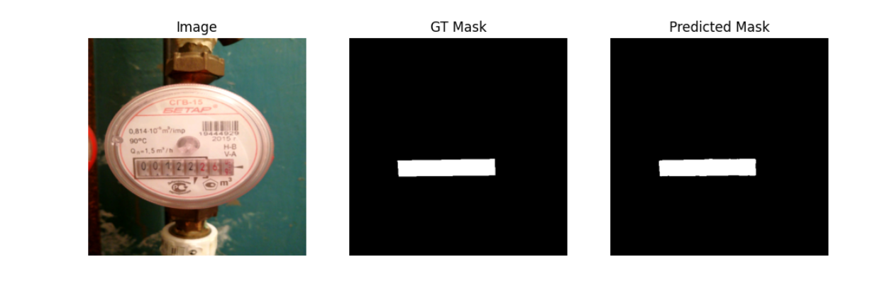
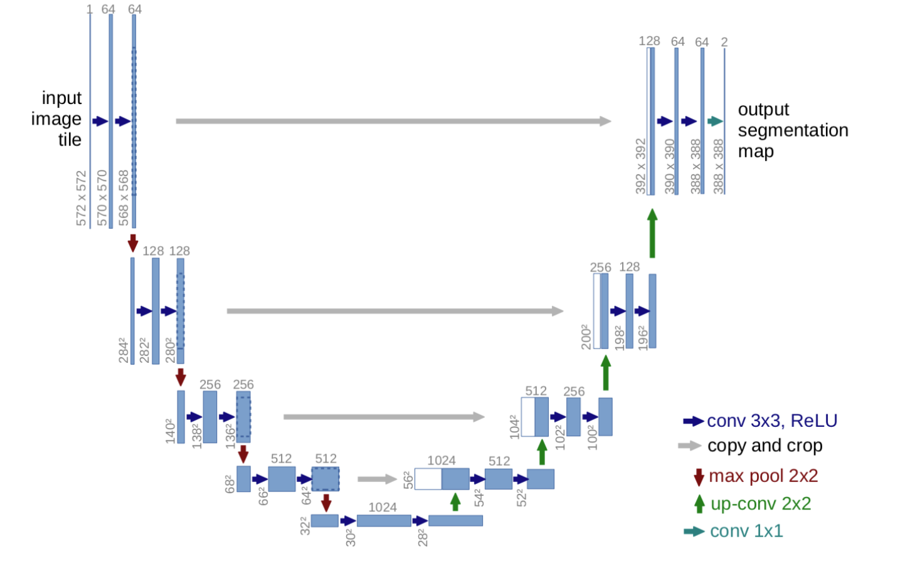

# Water Meters Segmentation

A deep learning project for segmenting water meter displays using U-Net architecture.

**Course**: Fundamentals of Artificial Intelligence

## Example



## Dataset

<a href="https://www.kaggle.com/datasets/tapakah68/yandextoloka-water-meters-dataset?resource=download-directory">Water Meters Dataset</a> (KUCEV ROMAN)

| Property | Value |
|----------|-------|
| Images | 1244 |
| Masks | 1244 |
| Format | JPG |
| Image type | RGB |
| Mask type | Grayscale |
| Scaled size | 512x512 |

**Data Split:**
- Train: 995 images (80%)
- Validation: 124 images (10%)
- Test: 125 images (10%)

## Model Architecture

Enhanced U-Net encoder-decoder architecture with double convolution blocks for binary segmentation.

| Component | Description |
|-----------|-------------|
| Encoder | 4 levels with double Conv2d blocks + BatchNorm2d + ReLU + MaxPool2d |
| Bottleneck | Deepest feature representation (256 channels) |
| Decoder | 4 levels with upsampling + skip connections + double Conv2d blocks |
| Output | 1 channel binary mask |

**Key improvements:**
- Double convolution blocks in each encoder/decoder level (standard U-Net architecture)
- 4 encoder levels (16→32→64→128→256 channels) for deeper feature extraction
- Symmetric decoder path with skip connections for precise localization

| Parameter | Value |
|-----------|-------|
| Input channels | 3 (RGB) |
| Output channels | 1 (binary mask) |
| Input size | 512x512 |
| Total parameters | 1,965,569 |
| Trainable parameters | 1,965,569 |

### Architecture Comparison

The implementation follows the original U-Net architecture [(Ronneberger et al., 2015)](https://medium.com/@coffee_and_notes/computer-vision-u-net-6d21e08b09d7) with modern improvements:



**Core U-Net principles maintained:**
- 4-level encoder-decoder with skip connections
- Double convolution blocks per stage
- Max pooling for downsampling
- Symmetric architecture

**Modern adaptations:**
- Smaller channel counts (16→256 vs. 64→1024) for efficient training on smaller datasets
- Batch normalization after each convolution for training stability
- Bilinear interpolation instead of transposed convolutions for smoother upsampling
- Same-padding convolutions to preserve spatial dimensions
- Optimized to 1.97M parameters (vs. ~31M in original)

## Results

**Final test set performance:**

| Metric | Value |
|--------|-------|
| Test Dice Coefficient | **0.9275** |
| Test IoU (Intersection over Union) | **0.8865** |
| Test Hausdorff Distance | **22.99** |
| Test Pixel Accuracy | **99.76%** |

**Training configuration:**
- Epochs: 51 (early stopping at epoch 51, best model at epoch 46)
- Learning rate: 1e-4 with ReduceLROnPlateau scheduler
- Optimizer: Adam with weight_decay=1e-4 (L2 regularization)
- Loss function: BCEWithLogitsLoss
- Batch size: 4

**Data augmentation (training only):**
- Random horizontal flip (p=0.5)
- Random vertical flip (p=0.3)
- Random rotation ±10° (p=0.5)
- Color jitter for brightness variation (p=0.3)

Training demonstrated excellent convergence with consistent improvement across all metrics. The model achieved state-of-the-art performance on water meter segmentation with Dice coefficient > 0.92 and IoU > 0.88.

### Training Progress (Selected Epochs)

| Epoch | Train Loss | Train Dice | Val Loss | Val Dice | Test Loss | Test Dice |
|-------|------------|------------|----------|----------|-----------|-----------|
| 1     | 0.5712     | 0.1748     | 0.4991   | 0.2948   | 0.4994    | 0.2988    |
| 10    | 0.1313     | 0.7545     | 0.1318   | 0.7424   | 0.1276    | 0.7856    |
| 20    | 0.0325     | 0.8940     | 0.0442   | 0.7175   | 0.0375    | 0.7912    |
| 30    | 0.0121     | 0.9261     | 0.0226   | 0.8796   | 0.0134    | 0.8988    |
| 40    | 0.0069     | 0.9426     | 0.0182   | 0.8999   | 0.0088    | 0.9212    |
| 46*   | 0.0055     | 0.9490     | **0.0166** | 0.9066 | 0.0084    | 0.9109    |
| 50    | 0.0054     | 0.9510     | 0.0171   | 0.9157   | 0.0069    | **0.9278** |

\* Epoch 46 achieved the best validation loss and was saved as the final model.

## Project Structure

```
Water-Meters-Segmentation/
├── .gitignore                    # Git ignore configuration
├── README.md                     # This file
├── Results/
│   ├── custom_images/            # Self-taken photos of water meters 
│   ├── custom_predictions/       # Predicted masks for self-taken photos
│   ├── Report_EN.md              # Comprehensive project report
│   ├── Report_PL.pdf             # Original Polish report (obsolete)
│   ├── Example_Prediction_*.png  # Example predictions (4 files)
│   ├── Pixel_Distribution_*.png  # Dataset statistics (3 files)
│   ├── Distribution_Set_Plot.png # Dataset split visualization
│   ├── plot_*.png                # Training curves (2 files)
│   └── Terminal.log              # Training output log
└── WMS/
    ├── data/
    │   ├── training/
    │   │   ├── images/           # [REQUIRED] Source images
    │   │   ├── masks/            # [REQUIRED] Source masks
    │   │   └── temp/             # [AUTO-GENERATED] Train/val/test splits
    │   │       ├── train/        #  80% of source
    │   │       ├── val/          #  10% of source
    │   │       └── test/         #  10% of source
    │   └── predictions/
    │       ├── photos_to_predict/  # [USER INPUT] Images to predict
    │       └── predicted_masks/    # [AUTO-GENERATED] Output masks
    ├── models/
    │   ├── best.pth              # [AUTO-GENERATED] Best checkpoint
    │   └── unet_epoch*.pth       # [AUTO-GENERATED] Epoch checkpoints
    └── src/
        ├── dataset.py            # PyTorch Dataset class
        ├── model.py              # U-Net architecture
        ├── transforms.py         # Image preprocessing + data augmentation
        ├── prepareDataset.py     # Data splitting (80/10/10)
        ├── train.py              # Training loop + metrics
        └── predicts.py           # Inference (no temp dirs needed)
```

**Key Notes:**
- `[REQUIRED]` directories must exist with data before training
- `[AUTO-GENERATED]` directories are created automatically by scripts
- `[USER INPUT]` directories are where you place new images for predictions
- The `temp/` directory is ignored by git (temporary training splits)
- `predicts.py` works independently with just `best.pth` and input images

## Requirements

- Python 3.x
- PyTorch 2.6.0+cu118
- Torchvision 0.21.0+cpu
- CUDA 11.8
- OpenCV (cv2)
- NumPy
- SciPy
- scikit-learn
- matplotlib
- torchsummary

## Usage

### Training Workflow

**Prerequisites:**
- Place your dataset in `WMS/data/training/`:
  - Images: `WMS/data/training/images/*.jpg`
  - Masks: `WMS/data/training/masks/*.jpg`

**1. Prepare Dataset (optional)**
```bash
python WMS/src/prepareDataset.py
```
- Splits data into train/val/test sets (80%/10%/10%)
- Creates temporary directories in `WMS/data/training/temp/`
- **Not required** - `train.py` runs this automatically

**2. Train Model**
```bash
python WMS/src/train.py
```
- Automatically runs `prepareDataset.py` first
- Trains U-Net for 50 epochs with early stopping
- Saves checkpoints to `WMS/models/`:
  - `best.pth` - Best model based on validation loss
  - `unet_epoch{N}.pth` - Checkpoint for each epoch
- Evaluates on train/val/test sets each epoch
- Displays training plots and sample predictions

### Inference Workflow

**Prerequisites:**
- A trained model: `WMS/models/best.pth`
- Input images: Place JPG files in `WMS/data/predictions/photos_to_predict/`

**Run Predictions**
```bash
python WMS/src/predicts.py
```
- Loads the best trained model
- Processes all `.jpg` files in `photos_to_predict/`
- Displays side-by-side comparisons (original | predicted mask)
- Saves predicted masks to `WMS/data/predictions/predicted_masks/`
- **No training required** - works with pre-trained models from GitHub

## Authors

- **Wojciech Szewczyk**
- **Rafal Zablotni**

## Documentation

- **[Report_EN.md](Results/Report_EN.md)** - Comprehensive project report in English with current results
- **[Report_PL.pdf](Results/Report_PL.pdf)** - Original academic report in Polish (contains obsolete results)
