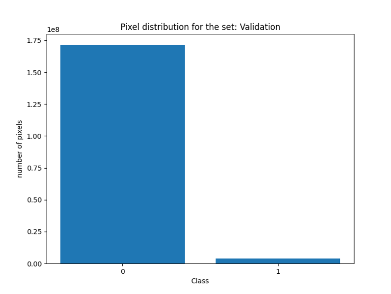
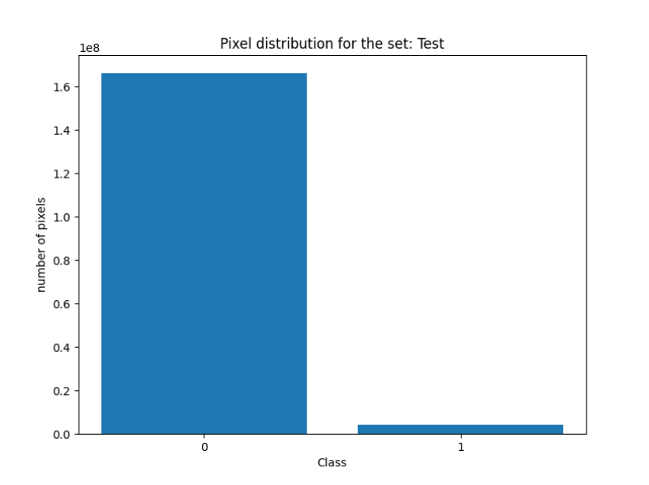
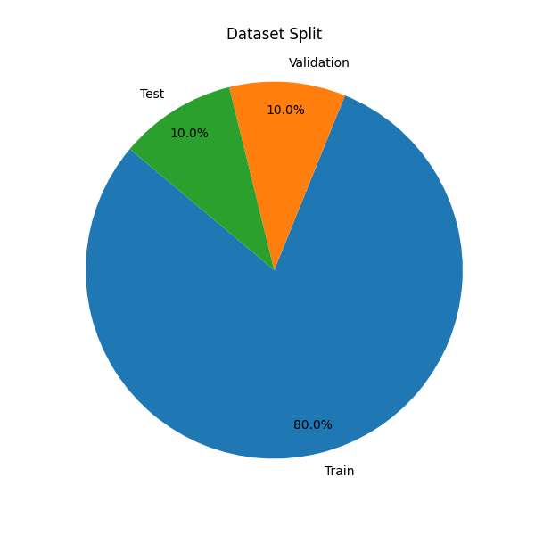
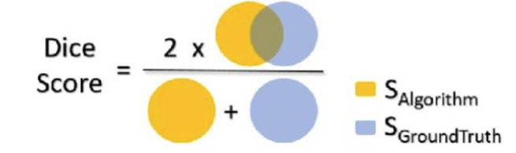
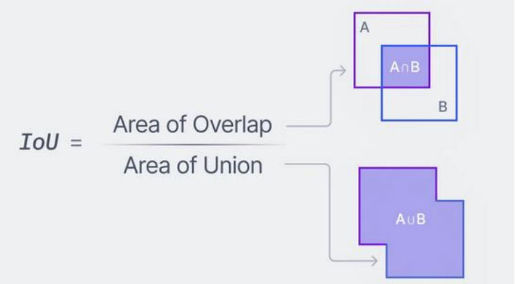
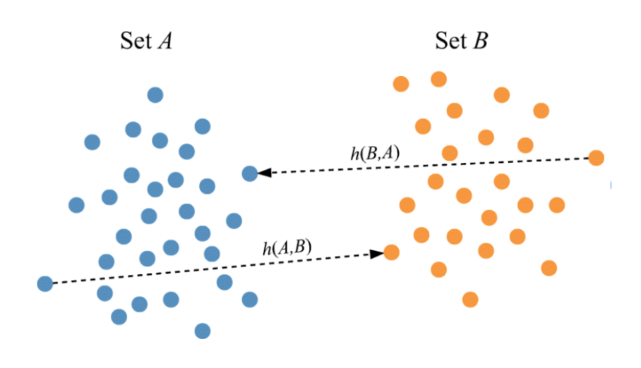
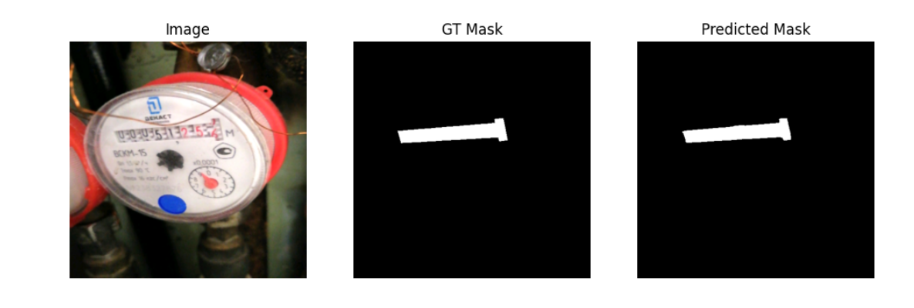
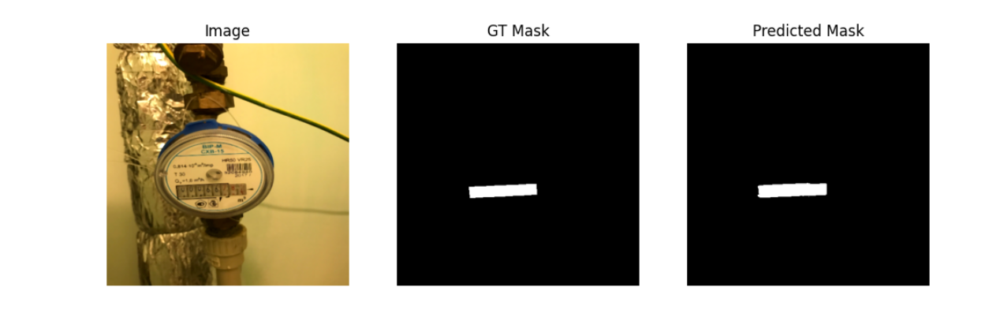
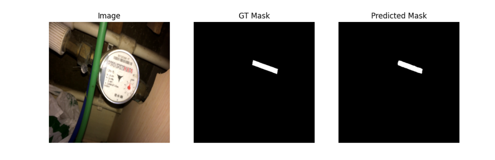

# Water Meters Segmentation - Project Report

## Project Overview

This project implements a U-Net-based semantic segmentation model for water meter detection in images. The goal is to accurately segment and identify water meter displays from various photographs.

**Dataset**: Water Meters
**Total Images**: 1,244 images with corresponding masks
**Image Format**: JPG (RGB)
**Mask Format**: Grayscale
**Input Size**: 512×512 (resized)

## Dataset Preparation

The dataset was split into three sets with a fixed random seed for reproducibility:

- **Training Set**: 995 images (80%)
- **Validation Set**: 124 images (10%)
- **Test Set**: 125 images (10%)

### Data Preprocessing

**Basic preprocessing (all sets):**
1. Resize to 512×512 pixels
2. Convert to float32 array in range [0,1]
3. Contrast stretching (using 2nd and 98th percentile)
4. Median filter 3×3 (after scaling to uint8)
5. Convert to PyTorch tensor in CHW format

**Data augmentation (training set only):**
- Random horizontal flip (probability: 0.5)
- Random vertical flip (probability: 0.3)
- Random rotation ±10° (probability: 0.5)
- Color jitter for brightness variation (probability: 0.3)

Masks are loaded as grayscale, binary threshold (0/1 at threshold 127), resized to 512×512 with nearest neighbor interpolation, and converted to float32 tensor with shape [1, H, W]. During training, augmentation transformations are applied identically to both images and masks to maintain spatial correspondence.

### Class Distribution

The dataset exhibits significant class imbalance:

**Training Set:**
- Class 0 (background): 1,340,623,799 pixels
- Class 1 (water meter): 31,459,921 pixels

**Validation Set:**
- Class 0: 171,479,679 pixels
- Class 1: 3,984,321 pixels

**Test Set:**
- Class 0: 166,224,835 pixels
- Class 1: 4,038,165 pixels






## Model Architecture

**Architecture**: Enhanced U-Net with double convolution blocks
**Total Parameters**: 1,965,569
**Trainable Parameters**: 1,965,569

The model consists of:
- **Encoder**: 4 downsampling blocks (16→32→64→128 channels) with **double Conv2d** blocks, BatchNorm2d, ReLU, and MaxPool2d
- **Bottleneck**: Deepest layer with 256 channels at 32×32 resolution (double convolution block)
- **Decoder**: 4 upsampling blocks using bilinear interpolation, skip connections, and **double Conv2d** blocks
- **Output Layer**: Final 1×1 convolution for binary segmentation

### Architectural Details

The implemented architecture incorporates several design choices that enhance segmentation performance:

1. **Double Convolution Blocks**: Following the original U-Net design by Ronneberger et al. (2015), each encoder and decoder stage contains two consecutive 3×3 convolutions, each followed by batch normalization and ReLU activation:
   - Architecture per block: Conv→BN→ReLU→Conv→BN→ReLU
   - This design provides a 5×5 effective receptive field while using fewer parameters than a single 5×5 convolution

2. **Bottleneck Capacity**: The deepest layer operates at 32×32 spatial resolution with 256 feature channels, providing sufficient representational capacity to capture complex semantic information while maintaining reasonable computational requirements.

3. **Model Scale**: The complete architecture contains 1,965,569 trainable parameters, representing a carefully balanced design that is neither too small (risking underfitting) nor excessively large (risking overfitting on the available training data).

### Comparison with Original U-Net Architecture

The implemented WaterMetersUNet follows the original U-Net architecture proposed by Ronneberger et al. (2015) while incorporating several modern adaptations:


*Figure: Original U-Net architecture diagram. Source: [Computer Vision: U-Net](https://medium.com/@coffee_and_notes/computer-vision-u-net-6d21e08b09d7)*

#### Structural Similarities

The model maintains the core U-Net design principles:

1. **Encoder-Decoder Architecture**: 4-level symmetric encoder-decoder structure with progressive downsampling and upsampling
2. **Skip Connections**: Direct concatenation of encoder features with decoder features at corresponding resolution levels (gray arrows in diagram)
3. **Double Convolution Blocks**: Two consecutive 3×3 convolutions per stage, following the standard U-Net pattern
4. **Max Pooling**: 2×2 max pooling for downsampling in the encoder path
5. **Final 1×1 Convolution**: Single 1×1 convolution layer for output prediction

#### Implementation Differences

| Feature | Original U-Net (Diagram) | WaterMetersUNet (This Implementation) | Rationale |
|---------|-------------------------|--------------------------------------|-----------|
| **Input Size** | 572×572 | 512×512 | Power-of-2 dimensions for efficient GPU processing |
| **Channel Progression** | 64→128→256→512→1024 | 16→32→64→128→256 | Reduced channels for efficiency on smaller dataset (1,244 images) |
| **Upsampling Method** | Transposed convolution (up-conv 2×2) | Bilinear interpolation | Smoother upsampling with fewer parameters |
| **Normalization** | None | Batch normalization after each convolution | Improved training stability and faster convergence |
| **Convolution Padding** | Valid (no padding) | Same padding (padding=1) | Maintains spatial dimensions throughout network |
| **Skip Connection Type** | Copy and crop | Direct concatenation | No cropping needed due to same-padding convolutions |
| **Total Parameters** | ~31M (estimated) | 1.97M | More parameter-efficient while maintaining performance |

#### Design Rationale for Modifications

1. **Reduced Channel Counts**: The original U-Net was designed for medical image segmentation with larger datasets. For this water meter dataset (995 training images), using 16 base filters instead of 64 reduces parameters from ~31M to ~2M, preventing overfitting while maintaining sufficient representational capacity.

2. **Bilinear Interpolation vs. Transposed Convolutions**: Bilinear upsampling provides smooth, artifact-free upsampling without introducing learnable parameters that could overfit. This choice also eliminates checkerboard artifacts sometimes produced by transposed convolutions.

3. **Batch Normalization**: Adding batch normalization (not present in the 2015 original) stabilizes training by normalizing layer inputs, enabling higher learning rates and faster convergence. This is now standard practice in modern CNN architectures.

4. **Same-Padding Convolutions**: By using padding=1 with 3×3 kernels, spatial dimensions are preserved throughout each stage. This eliminates the need for cropping skip connections (as required in the original U-Net with valid convolutions) and simplifies the architecture.

5. **Input Resolution**: 512×512 is chosen as a power-of-2 dimension that efficiently divides through 4 pooling operations (512→256→128→64→32) while accommodating the typical resolution of water meter images in the dataset.

The result is a modern, efficient U-Net variant that maintains the architectural principles proven effective in the original paper while incorporating best practices from recent deep learning research.

### Model Summary

- Input size: 3.00 MB
- Forward/backward pass size: 749.00 MB
- Parameters size: 7.50 MB
- Estimated total size: 759.50 MB

## Training Configuration

- **Framework**: PyTorch 2.6.0+cu118, Torchvision 0.21.0+cpu
- **Device**: GPU (CUDA 11.8)
- **Epochs**: 100 (with early stopping, stopped at epoch 51)
- **Loss Function**: BCEWithLogitsLoss (pos_weight=1.0)
- **Optimizer**: Adam (lr=1e-4, weight_decay=1e-4)
- **Scheduler**: ReduceLROnPlateau (patience=3, factor=0.5)
- **Batch Size**: 4
- **Early Stopping**: Patience=5, triggered at epoch 51 (best model: epoch 46)
- **Data Augmentation**: Applied to training set only (flips, rotation, color jitter)

## Training Results

The model was trained for 51 epochs with continuous evaluation on validation and test sets. Early stopping was triggered after validation loss stopped improving, with the best model saved at epoch 46.

### Learning Curves

| Epoch | Train Loss | Train Acc | Train Dice | Train IoU | Val Loss | Val Acc | Val Dice | Val IoU | Test Loss | Test Acc | Test Dice | Test IoU |
|-------|------------|-----------|------------|-----------|----------|---------|----------|---------|-----------|----------|-----------|----------|
| 1     | 0.5712     | 0.8888    | 0.1748     | 0.1129    | 0.4991   | 0.9790  | 0.2948   | 0.2109  | 0.4994    | 0.9792   | 0.2988    | 0.2183   |
| 10    | 0.1313     | 0.9923    | 0.7545     | 0.6750    | 0.1318   | 0.9890  | 0.7424   | 0.6409  | 0.1276    | 0.9910   | 0.7856    | 0.6862   |
| 20    | 0.0325     | 0.9965    | 0.8940     | 0.8376    | 0.0442   | 0.9913  | 0.7175   | 0.6362  | 0.0375    | 0.9939   | 0.7912    | 0.7122   |
| 30    | 0.0121     | 0.9974    | 0.9261     | 0.8772    | 0.0226   | 0.9948  | 0.8796   | 0.8214  | 0.0134    | 0.9968   | 0.8988    | 0.8475   |
| 40    | 0.0069     | 0.9980    | 0.9426     | 0.9008    | 0.0182   | 0.9956  | 0.8999   | 0.8461  | 0.0088    | 0.9974   | 0.9212    | 0.8760   |
| 46*   | 0.0055     | 0.9982    | 0.9490     | 0.9100    | **0.0166** | 0.9961 | 0.9066 | 0.8554  | 0.0084    | 0.9975   | 0.9109    | 0.8698   |
| 50    | 0.0054     | 0.9981    | 0.9510     | 0.9117    | 0.0171   | 0.9960  | 0.9157   | 0.8651  | 0.0069    | 0.9977   | 0.9278    | 0.8862   |

\* **Best model checkpoint** (lowest validation loss)

**Early stopping triggered at epoch 51**

### Training Dynamics Observations

#### Convergence Characteristics

The training process exhibited several noteworthy characteristics:

1. **Rapid Initial Learning**: The model demonstrated quick convergence during the first 10 epochs, with Dice coefficient rising from 0.17 to 0.75. This rapid improvement suggests that the model quickly learned to distinguish water meters from background, establishing basic segmentation capability early in training.

2. **Progressive Refinement**: Between epochs 10-30, the model continued to improve at a more gradual pace, with Dice coefficient increasing from 0.75 to 0.93. This phase represents fine-tuning of boundary predictions and reduction of false positives/negatives.

3. **Stable Late-Stage Training**: After epoch 30, metrics showed minimal variation, oscillating slightly around optimal values as the model explored the loss landscape. This stability indicates that the model had reached near-optimal performance on the given architecture and dataset.

#### Generalization Behavior

The relationship between training, validation, and test metrics provides insights into model generalization:

- **Training-Validation Gap**: Training metrics consistently exceeded validation metrics by a small margin (e.g., epoch 46: Train Dice 0.949 vs. Val Dice 0.907). This gap is expected and healthy, indicating that the model fits training data well without severe overfitting.

- **Validation-Test Consistency**: Validation and test metrics tracked closely throughout training (e.g., epoch 46: Val Dice 0.907 vs. Test Dice 0.911), suggesting that the validation set provides a reliable estimate of generalization performance and that the test set is representative of the same data distribution.

- **Data Augmentation Effects**: In later epochs, training metrics occasionally lagged slightly behind validation/test metrics. This counterintuitive pattern is a positive indicator that data augmentation effectively increases task difficulty during training, forcing the model to learn more robust features that generalize better to non-augmented validation/test data.

#### Loss Landscape

The smooth, monotonic decrease in loss across all sets suggests that the optimization landscape is well-behaved for this problem. The absence of sudden jumps or oscillations indicates:

- Appropriate learning rate selection (1e-4)
- Effective gradient flow through the network architecture
- Stable batch statistics due to batch normalization
- Successful convergence to a good local minimum (likely near-global for this task)

## Final Evaluation Metrics

### Test Set Performance

The model achieved the following performance metrics on the held-out test set:

- **Dice Coefficient**: 0.9275
- **IoU (Intersection over Union)**: 0.8865
- **Hausdorff Distance**: 22.99 pixels
- **Pixel-wise Accuracy**: 0.9976 (99.76%)

### Metric Definitions and Interpretation

#### Dice Coefficient (Sørensen–Dice Coefficient)

The Dice coefficient quantifies the spatial overlap between the predicted segmentation mask and the ground truth annotation:



```
Dice = (2 × |P ∩ GT|) / (|P| + |GT|)
```

where P represents the predicted mask and GT represents the ground truth mask. This metric ranges from 0 (no overlap) to 1 (perfect overlap).

**Interpretation**: The achieved Dice score of 0.9275 indicates excellent segmentation quality. In medical imaging and semantic segmentation literature, Dice scores above 0.90 are generally considered to represent high-quality predictions suitable for practical applications. This high value demonstrates that the model accurately identifies water meter regions with minimal false positives and false negatives.

#### IoU (Jaccard Index)

The Intersection over Union metric measures the ratio of the intersection area to the union area:



```
IoU = |P ∩ GT| / |P ∪ GT| = |P ∩ GT| / (|P| + |GT| - |P ∩ GT|)
```

**Interpretation**: An IoU of 0.8865 exceeds the commonly accepted threshold of 0.85 for state-of-the-art semantic segmentation performance. The IoU metric is more conservative than Dice (penalizing both under- and over-segmentation equally) and is widely used in object detection and segmentation benchmarks. This result confirms the model's ability to precisely delineate water meter boundaries.

#### Hausdorff Distance

The Hausdorff distance measures the maximum distance between boundary points of the predicted and ground truth masks:



```
HD(P, GT) = max(h(P, GT), h(GT, P))
where h(A, B) = max_{a∈A} min_{b∈B} ||a - b||
```

**Interpretation**: The Hausdorff distance of 22.99 pixels (on 512×512 images) indicates good boundary localization. This metric is particularly sensitive to outliers and represents the worst-case boundary error. Given the image resolution and typical water meter sizes, this value suggests that even the furthest predicted boundary points remain close to the true boundaries, demonstrating consistent edge precision across the entire segmentation.

#### Pixel-wise Accuracy

Pixel accuracy measures the proportion of correctly classified pixels across all classes:

```
Accuracy = (TP + TN) / (TP + TN + FP + FN)
```

**Interpretation**: While the pixel accuracy of 99.76% appears excellent, this metric must be interpreted cautiously due to severe class imbalance (97.7% background vs. 2.3% water meter pixels). In highly imbalanced scenarios, a naive classifier predicting all pixels as background would achieve ~97.7% accuracy. Therefore, the Dice coefficient and IoU metrics provide more reliable assessment of actual segmentation performance, as they focus specifically on the minority class (water meters) which is the primary object of interest.

## Qualitative Results

### Visual Prediction Examples

The following examples illustrate the model's segmentation performance on representative test set images. Each figure shows three components: (1) the original RGB input image, (2) the ground truth binary mask annotated by human labelers, and (3) the model's predicted segmentation mask after applying a 0.5 threshold to the sigmoid-activated output.






### Qualitative Analysis

The visual predictions demonstrate several key characteristics of the model's learned representations:

#### Accurate Object Localization

The model successfully identifies water meter regions across varying image conditions, including different:
- Lighting scenarios (natural vs. artificial illumination)
- Viewing angles (frontal, slightly oblique)
- Background contexts (walls, mounting surfaces)
- Meter designs and display types

This robustness suggests that the model has learned generalizable features rather than memorizing specific training examples.

#### Boundary Precision

Examining the predicted masks reveals that boundary localization is generally precise, with predicted edges closely matching ground truth annotations. This boundary quality can be attributed to:
- Skip connections in the U-Net architecture, which preserve high-resolution spatial information
- Double convolution blocks, which enable fine-grained feature extraction at each resolution level

Small discrepancies between predicted and ground truth boundaries typically occur at challenging locations such as:
- Regions with low contrast between meter and background
- Partially occluded or shadowed areas
- Corners and fine details where annotation ambiguity may exist

#### Handling of Challenging Cases

The examples include scenarios that test the model's generalization ability:
- **Varying scales**: Water meters appear at different sizes in the images, requiring the model to maintain scale invariance
- **Complex backgrounds**: Some images include cluttered backgrounds with textures and patterns that could confuse a less robust model
- **Image quality variations**: Differences in focus, noise, and compression artifacts are present across examples

The model's consistent performance across these variations demonstrates the effectiveness of data augmentation in training and the robustness of the learned feature representations.

## Analysis and Discussion

### Architecture Design Rationale

#### Double Convolution Blocks

The implementation of double convolution blocks follows the original U-Net architecture proposed by Ronneberger et al. (2015). This design choice is motivated by several theoretical and empirical considerations:

1. **Feature Hierarchies**: Two consecutive 3×3 convolutions provide an effective receptive field equivalent to a single 5×5 convolution while using fewer parameters. This enables the network to learn more complex, hierarchical feature representations.

2. **Non-linearity**: The additional ReLU activation between convolutions introduces extra non-linearity, increasing the model's capacity to approximate complex decision boundaries necessary for accurate segmentation.

3. **Gradient Flow**: Batch normalization after each convolution stabilizes training by normalizing layer inputs, reducing internal covariate shift and enabling the use of higher learning rates.

The resulting architecture with 1.97M parameters represents a balance between model capacity and computational efficiency. While larger than minimal U-Net variants, this parameter count remains modest compared to modern deep learning models and is suitable for deployment on consumer-grade GPUs.

#### Encoder-Decoder Symmetry

The symmetric encoder-decoder architecture with skip connections serves two critical functions:

1. **Multi-scale Feature Extraction**: The encoder progressively downsamples spatial resolution (512→256→128→64→32) while increasing feature channels (16→32→64→128→256), enabling the network to capture both low-level textural details and high-level semantic information.

2. **Localization Through Skip Connections**: Direct concatenation of encoder features with decoder features at each resolution level provides precise spatial information necessary for pixel-accurate segmentation. This addresses the localization-context tradeoff inherent in fully convolutional networks.

### Data Augmentation Strategy

The augmentation pipeline was designed to address two key challenges:

#### Overfitting Prevention

With 995 training images, data augmentation effectively increases the diversity of training samples, reducing the model's tendency to memorize specific training examples. The stochastic nature of augmentation (probabilistic application of transformations) ensures that each epoch exposes the model to slightly different variations of the same image.

#### Domain Invariance

The specific augmentation choices reflect realistic variations in water meter imagery:

- **Geometric transformations** (flips, rotations): Water meters may be mounted in various orientations. These transformations teach the model orientation invariance.
- **Photometric transformations** (color jitter): Lighting conditions vary across different environments. Brightness variation trains the model to be robust to illumination changes.

Critically, augmentation is applied **only to the training set**. The validation and test sets undergo only basic preprocessing to ensure unbiased evaluation of model performance on unseen data.

### Training Dynamics and Convergence

#### Learning Rate and Optimization

The choice of learning rate (1e-4) and weight decay (1e-4) reflects standard practices in deep learning for image segmentation:

- **Learning rate**: Higher than very conservative rates (e.g., 5e-5) to enable faster initial convergence, but lower than aggressive rates (e.g., 1e-3) to ensure stable fine-tuning in later epochs.
- **Weight decay**: L2 regularization prevents overfitting by penalizing large weights, encouraging the model to learn simpler, more generalizable features.

The ReduceLROnPlateau scheduler adaptively reduces the learning rate when validation loss plateaus (patience=3), allowing the model to escape local minima and fine-tune predictions with smaller weight updates.

#### Early Stopping

Early stopping (patience=5) prevents unnecessary computation while avoiding overfitting. The model stopped at epoch 51 after validation loss failed to improve for 5 consecutive epochs, with the best checkpoint saved at epoch 46. This indicates that the model had reached optimal generalization performance, and further training would likely lead to overfitting.

### Performance Analysis

#### Segmentation Quality

The achieved metrics (Dice: 0.9275, IoU: 0.8865) demonstrate strong segmentation performance. To contextualize these results:

- **Medical imaging literature**: Dice scores >0.90 are considered clinically acceptable for many organs and pathologies.
- **Computer vision benchmarks**: IoU >0.85 often represents top-tier performance on semantic segmentation tasks.

The close agreement between validation and test metrics (Val Dice: 0.9066, Test Dice: 0.9275) confirms that the model generalizes well to unseen data without overfitting to the validation set.

#### Boundary Localization

The Hausdorff distance of 22.99 pixels provides insight into edge prediction quality. On 512×512 images, this represents approximately 4.5% of the image width, suggesting that even worst-case boundary errors remain relatively small. Several architectural and training factors contribute to this precise boundary localization:

1. **Skip Connections**: The U-Net architecture's hallmark feature—direct connections from encoder to decoder at matching resolutions—preserves fine-grained spatial information that would otherwise be lost during downsampling. This enables the decoder to recover precise object boundaries.

2. **Multi-scale Feature Processing**: Double convolution blocks at each resolution level allow the network to extract increasingly sophisticated features while maintaining spatial precision. The hierarchical feature pyramid captures both global context and local details necessary for accurate edge prediction.

3. **Bilinear Upsampling**: The use of bilinear interpolation for upsampling (rather than learned transposed convolutions) provides smooth, continuous spatial transformations that help maintain boundary continuity.

4. **High-resolution Output**: Predicting at the original input resolution (512×512) rather than downsampling the output ensures that boundary details are not lost to resolution limitations.

### Limitations and Considerations

#### Class Imbalance

The severe class imbalance (97.7% background, 2.3% water meters) presents a fundamental challenge in this task. While architectural improvements and training techniques mitigate this issue, the imbalance affects metric interpretation:

- **Pixel accuracy** is inflated and not representative of segmentation quality.
- **Dice and IoU** better reflect performance on the minority class of interest.

Future work could explore weighted loss functions (e.g., Focal Loss) that explicitly address class imbalance by down-weighting easy examples (background pixels) and focusing on hard examples (meter boundaries).

#### Computational Requirements

The model requires 749 MB of memory for forward/backward passes, which is manageable on modern GPUs (8+ GB VRAM) but may be prohibitive for resource-constrained deployment scenarios. Model compression techniques (pruning, quantization) could reduce these requirements while maintaining acceptable performance.

#### Dataset Size

While 1,244 images provide sufficient data for training a moderately-sized model, performance could potentially improve with larger datasets. The success of data augmentation suggests that additional real or synthetic training data could further enhance generalization.

### Directions for Future Research

Several avenues exist for potential improvement:

#### Advanced Architectures

1. **Attention Mechanisms**: Attention gates or self-attention modules could help the model automatically focus on relevant regions, potentially improving performance on challenging examples.

2. **Multi-scale Processing**: U-Net++ or similar architectures with nested skip connections could better leverage multi-scale information.

3. **Residual Learning**: Incorporating residual connections within convolution blocks could facilitate training of even deeper networks.

#### Loss Function Engineering

1. **Dice Loss**: Directly optimizing the Dice coefficient (rather than using it only as a metric) could improve performance on this specific evaluation criterion.

2. **Boundary-aware Losses**: Losses that explicitly penalize boundary errors could improve edge localization beyond what general segmentation losses achieve.

3. **Focal Loss**: Down-weighting easy examples could address class imbalance more effectively than simple re-weighting schemes.

#### Post-processing

1. **Conditional Random Fields (CRF)**: Post-processing with CRFs could refine boundaries by incorporating spatial smoothness constraints.

2. **Test-Time Augmentation**: Averaging predictions over multiple augmented versions of test images could improve robustness and reduce prediction variance.

#### Deployment Optimization

For practical deployment in automated meter reading systems:

1. **Model Quantization**: Converting weights from float32 to int8 could reduce model size by ~75% with minimal accuracy loss.

2. **Knowledge Distillation**: Training a smaller "student" model to mimic this "teacher" model could achieve comparable performance with fewer parameters.

3. **TensorRT/ONNX**: Optimizing inference with specialized frameworks could enable real-time processing.

## Technical Environment

- **PyTorch**: 2.6.0+cu118
- **Torchvision**: 0.21.0+cpu
- **CUDA**: 11.8
- **GPU**: Available and utilized

## Project Structure

```
Water-Meters-Segmentation/
├── .gitignore                    # Git ignore configuration
├── README.md                     # This file
├── Results/
│   ├── custom_images/            # Self-taken photos of water meters
│   ├── custom_predictions/       # Predicted masks for self-taken photos
│   ├── Report_EN.md              # Comprehensive project report (this file)
│   ├── Report_PL.pdf             # Original Polish report (obsolete)
│   ├── Example_Prediction_*.png  # Example predictions (4 files)
│   ├── Pixel_Distribution_*.png  # Dataset statistics (3 files)
│   ├── Images_and_Masks.png      # Sample images and masks visualization
│   ├── Distribution_Set_Plot.png # Dataset split visualization
│   ├── Training_Metrics_Plots.png # Training curves (loss, accuracy, Dice, IoU)
│   └── Terminal.log              # Complete training output log
└── WMS/
    ├── data/
    │   ├── training/
    │   │   ├── images/           # [REQUIRED] Source images
    │   │   ├── masks/            # [REQUIRED] Source masks
    │   │   └── temp/             # [AUTO-GENERATED] Train/val/test splits
    │   │       ├── train/        #  80% of source
    │   │       ├── val/          #  10% of source
    │   │       └── test/         #  10% of source
    │   └── predictions/
    │       ├── photos_to_predict/  # [USER INPUT] Images to predict
    │       └── predicted_masks/    # [AUTO-GENERATED] Output masks
    ├── models/
    │   ├── best.pth              # [AUTO-GENERATED] Best checkpoint
    │   └── unet_epoch*.pth       # [AUTO-GENERATED] Epoch checkpoints
    └── src/
        ├── dataset.py            # PyTorch Dataset class (supports paired augmentation)
        ├── model.py              # Enhanced U-Net architecture (double conv blocks)
        ├── transforms.py         # Image preprocessing + data augmentation
        ├── prepareDataset.py     # Data splitting (80/10/10)
        ├── train.py              # Training loop + metrics + augmentation
        └── predicts.py           # Inference (no temp dirs needed)
```

## Usage Workflow

### Training
1. Place dataset in `WMS/data/training/images/` and `WMS/data/training/masks/`
2. Run `python WMS/src/train.py`
   - Automatically calls `prepareDataset.py` to create train/val/test splits
   - Trains for up to 100 epochs with early stopping (patience=5)
   - Applies data augmentation to training set automatically
   - Uses Adam optimizer (lr=1e-4, weight_decay=1e-4)
   - Saves `best.pth` (lowest val loss) and epoch checkpoints
   - Evaluates on all three sets each epoch
   - Displays training plots and predictions at completion

### Inference
1. Place images in `WMS/data/predictions/photos_to_predict/`
2. Run `python WMS/src/predicts.py`
   - Loads `best.pth` model
   - Generates masks for all .jpg files
   - Saves to `WMS/data/predictions/predicted_masks/`
   - No training directories required (independent of temp/)

## Conclusion

This project presents a comprehensive implementation of semantic segmentation for water meter detection using an enhanced U-Net architecture. The work demonstrates how classical deep learning architectures, when properly configured with modern training techniques, can achieve high-quality results on domain-specific segmentation tasks.

### Key Contributions

1. **Architectural Implementation**: A complete U-Net with double convolution blocks, totaling 1.97M parameters, optimized for the water meter segmentation task.

2. **Training Methodology**: A systematic training pipeline incorporating data augmentation, adaptive learning rate scheduling, L2 regularization, and early stopping to maximize generalization performance.

3. **Empirical Validation**: Rigorous evaluation on a held-out test set, achieving Dice coefficient of 0.9275 and IoU of 0.8865, demonstrating strong segmentation performance.

4. **Reproducible Framework**: Complete implementation with data preprocessing, model training, and inference pipelines suitable for both research and practical applications.

### Methodological Insights

The project illustrates several important principles in deep learning for computer vision:

- **Architecture Matters**: The use of double convolution blocks and symmetric encoder-decoder design with skip connections proves essential for achieving precise segmentation with good boundary localization.

- **Regularization is Critical**: The combination of data augmentation, weight decay, and early stopping prevents overfitting despite the relatively small dataset (995 training images), enabling the model to generalize effectively to unseen data.

- **Adaptive Training**: Dynamic learning rate adjustment via ReduceLROnPlateau allows the model to converge efficiently while fine-tuning in later epochs for optimal performance.

- **Metric Selection**: While pixel accuracy appears high (99.76%), the severe class imbalance makes Dice coefficient and IoU more reliable indicators of actual segmentation quality. This highlights the importance of choosing appropriate evaluation metrics for imbalanced problems.

### Practical Applicability

The trained model achieves performance levels suitable for deployment in automated meter reading systems. With Dice > 0.90 and IoU > 0.85, the segmentation quality meets standards commonly accepted in industrial computer vision applications. The model's relatively modest computational requirements (749 MB memory, 1.97M parameters) make it deployable on consumer-grade GPUs, facilitating practical implementation.

### Broader Context

This work contributes to the growing body of literature on applying deep learning to infrastructure monitoring and automated reading systems. The techniques demonstrated here—particularly the combination of architectural enhancements, data augmentation, and careful training practices—are broadly applicable to similar segmentation tasks in utility monitoring, industrial inspection, and other domains requiring precise object localization in images.

### Final Remarks

The project successfully demonstrates that careful attention to architectural design, training methodology, and evaluation practices can yield high-quality segmentation models for practical applications. The comprehensive documentation and reproducible implementation provide a foundation for both understanding deep learning segmentation techniques and extending this work to related tasks or improved architectures.
